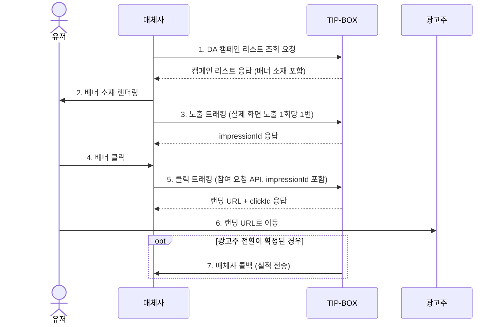

# DA API guide for publisher

### Getting Started

- 본 가이드는 TIP-BOX **DA(디스플레이) 광고**와 매체사 API 연동에 대한 내용입니다
- 매체사는 TIP-BOX의 DA 캠페인(배너 소재)을 받아 지면에 노출하고, 노출·클릭을 TIP-BOX로 전달합니다
- 오퍼월 캠페인 연동은 [Offerwall API guide for publisher](Offerwall%20API%20guide%20for%20publisher.md) 를 참고해주세요

### 연동 흐름도



### Prerequisites

- TIP-BOX 매체 어드민에서 **DA(디스플레이) 타입** 채널을 등록하고, 승인(ACTIVE) 후 발급되는 channelKey를 API 인증에 사용합니다
  (채널 타입이 DA가 아닌 channelKey로 호출하면 `CHANNEL_TYPE_MISMATCH` 오류가 반환됩니다)
- 실적 콜백을 수신하려면 채널 등록 시 콜백 URL을 함께 설정합니다 (섹션 4 참고)

---
# 1.DA 캠페인 리스트 조회 API

- 5분 주기로 업데이트 받는 것을 추천드립니다
- method : GET
- production API url : https://ad.tip-box.kr/api/v1/reward/display/campaigns
- test API url : http://dev.qtbit.co.kr:8037/api/v1/reward/display/campaigns

- parameter : channelKey (필수), p (선택), inventoryType (선택)


| 항목         | 설명      | 필수 | 비고                                                                         |
|------------|---------|----|----------------------------------------------------------------------------|
| channelKey | 매체사 채널 식별키 | O  | 매체 어드민에서 채널 승인 시 발급                                                       |
| p        | 플랫폼     |    | 기본 값은 전체이며, 구분하여 받을 경우 Android : 1, iOS : 2로 요청 (그 외 값은 오류)            |
| inventoryType | 배너 유형 |    | 기본 값은 전체이며, 구분하여 받을 경우 FRONT_BANNER(전면), BOX_BANNER(박스), STICKY_BANNER(띠)로 요청. 대소문자 무관 (그 외 값은 오류). 아래 "배너 유형 필터" 참고 |
- 요청 예시 : https://ad.tip-box.kr/api/v1/reward/display/campaigns?channelKey={channelKey}
- 배너 유형 지정 요청 예시 : https://ad.tip-box.kr/api/v1/reward/display/campaigns?channelKey={channelKey}&inventoryType=BOX_BANNER

> 파라미터 이름은 `inventoryType`(camelCase)입니다. 응답 필드 이름인 `inventory_type`(snake_case)으로 보내면 인식되지 않아 **오류 없이 전체 목록이 응답**됩니다.

> 응답에는 본 문서에 기재되지 않은 필드가 포함될 수 있으며, 매체사는 이를 무시해야 합니다.


| 항목                   | 형태            | 설명                                     | 비고                                                                                                          |
|----------------------|---------------|----------------------------------------|-------------------------------------------------------------------------------------------------------------|
| result               | int           | 응답 결과 값                                | 200인 경우에만 정상                                                                                          |
| cnt                  | int           | 캠페인 수                                  |                                                                                                             |
| camp                 | array         | 캠페인 리스트                                |                                                                                                             |
| camp.adGroupId       | long          | 캠페인 식별값                                | 노출·클릭 트래킹 요청의 `adGroupId` 로 사용합니다                                                                    |
| camp.os              | string        | 모바일 OS                                 | ANDROID, IOS. p를 지정하지 않으면 동일 캠페인의 OS별 광고가 하나로 합쳐져 `ANDROID,IOS` 형태로 내려올 수 있습니다              |
| camp.name            | string(255)   | 캠페인명                                   |                                                                                                             |
| camp.price           | int           | 캠페인 단가                                 | 매체 채널에 설정된 요율이 적용된 값                                                                                    |
| camp.rewarddesc      | string(50)    | 캠페인 적립 조건 안내 (불필요한 태그 제거)              | 값이 없으면 null                                                                                                 |
| camp.daily_cap       | int           | 오늘 해당 매체가 참여 가능한 남은 수량                  | 0: 일일 한도 미설정 (일일 한도가 소진된 캠페인은 리스트에서 제외됩니다)                                                         |
| camp.enddate         | string(8)     | 캠페인 종료일                                | YYYYMMDD                                                                                                    |
| camp.iconurl         | string(255)   | 캠페인의 아이콘 이미지 url                       | DA 캠페인은 아이콘이 없을 수 있으며, 이 경우 null                                                                       |
| camp.ctv             | array         | 배너 소재 정보                               | 세부 항목 참고. 소재가 없으면 빈 배열                                                                                 |
| camp.inventory_type  | string        | 배너 유형                                  | FRONT_BANNER, BOX_BANNER, STICKY_BANNER, HOME_NOTICE_BANNER, NONE. inventoryType 을 지정하면 요청한 유형, 지정하지 않으면 캠페인에 등록된 유형. 등록된 유형이 없으면 필드가 생략됩니다 |


camp -> ctv 세부 항목

| 항목   | 형태          | 설명                            |
|------|-------------|-------------------------------|
| type | int         | 배너 규격 코드 (아래 표 참고). 규격 정보가 없는 소재는 null |
| url  | string(255) | 소재 url                        |

ctv.type 배너 규격

| type | 규격       | 설명          |
|------|----------|-------------|
| 1    | 1200*600 | 가로형 (2:1)   |
| 2    | 720*780  | 세로형         |
| 3    | 640*960  | 세로형         |
| 4    | 640*100  | 가로형 띠배너     |

- `ctv.type` 은 소재 이미지의 규격(비율)을 나타내는 코드입니다. 지면 위치(전면/박스/띠 등)를 지정하는 값이 아니므로, 매체사는 자사 지면 규격에 맞는 type의 소재를 선택해 사용해주세요.
- 한 캠페인에 모든 규격의 소재가 있는 것은 아닙니다. 필요한 규격이 없는 캠페인은 노출하지 않거나 다른 규격으로 대체해주세요.

#### 배너 유형 필터 (inventoryType)

`inventoryType` 을 지정하면 해당 지면에 맞는 캠페인만 응답합니다. 배너 유형과 `ctv.type` 의 대응은 아래와 같습니다.

| inventoryType | 지면 | 대응 ctv.type |
|---------------|------|---------------|
| FRONT_BANNER  | 전면 배너 | 2 (720*780), 3 (640*960) |
| BOX_BANNER    | 박스 배너 | 1 (1200*600) |
| STICKY_BANNER | 띠 배너   | 4 (640*100) |

- 규격 정보가 있는 소재를 가진 캠페인은 대응 규격의 소재가 있을 때만 응답에 포함되며, `ctv` 에는 **대응 규격의 소재만** 남습니다.
- 규격 정보가 있는 소재가 없는 캠페인은 등록된 배너 유형이 요청한 유형과 같을 때 포함되며, `ctv` 는 그대로 응답됩니다.
- `inventoryType` 을 지정하지 않으면 필터 없이 전체 캠페인을 응답합니다. 이때 `camp.inventory_type` 은 등록된 값을 그대로 전달하는 것이므로, 지면에 맞는 소재 선택은 `ctv.type` 을 기준으로 해주세요.
- `HOME_NOTICE_BANNER`·`NONE` 은 응답 값으로만 쓰이며, `inventoryType` 요청 값으로 보내면 오류(400)로 처리됩니다.


#### 응답 예시
```json
{
    "result": 200,
    "cnt": 1,
    "camp": [
        {
            "adGroupId": 512301,
            "name": "OO카드 신규 발급 이벤트",
            "os": "ANDROID,IOS",
            "price": 10,
            "rewarddesc": "배너 클릭 후 이벤트 페이지 방문",
            "daily_cap": 500,
            "enddate": "20261231",
            "iconurl": null,
            "inventory_type": "FRONT_BANNER",
            "ctv": [
                {
                    "type": 1,
                    "url": "https://cdn.example.com/banner_1200-600.png"
                },
                {
                    "type": 4,
                    "url": "https://cdn.example.com/banner_640-100.png"
                }
            ]
        }
    ]
}
```

> **에러 응답**
>
> 에러가 발생해도 HTTP 상태 코드는 200으로 응답하며, 응답 본문에 `result` 대신 `status`·`code`·`message` 가 내려갑니다.
> - 201 : channelKey 누락 (`INVALID_TOKEN`)
> - 400 : 잘못된 요청 (`BAD_REQUEST` p 값 또는 inventoryType 값 오류, `CHANNEL_TYPE_MISMATCH` DA 타입이 아닌 채널)
> - 405 : 등록되지 않은 channelKey (`MEDIA_NOT_FOUND`)

---
# 2.노출 트래킹 (Impression Tracker)

- 배너 소재가 **사용자 화면에 실제로 노출된 시점**에 호출하여 노출을 집계합니다.
- **실제 노출 1회당 정확히 1번만 호출해주세요.** 서버는 노출 요청을 중복 제거하지 않으며, 호출할 때마다 노출 1건으로 집계됩니다. 리스트 수신·프리로드·재렌더링 시점에 호출하면 노출 수가 부풀려집니다.
- 응답으로 받은 `impressionId` 는 해당 노출에서 발생한 클릭 트래킹(섹션 3) 요청에 함께 전달합니다.

### 요청
- method : GET
- production API url : https://reward.tip-box.kr/api/impression
- test API url : https://dev.qtbit.co.kr:8436/api/impression

> **매크로 매핑 기반 파라미터 전달**
>
> 매체 어드민의 **채널 관리 > 매크로 설정**에서 구성한 매크로 매핑에 따라 파라미터가 처리됩니다.
> 매체사는 자사 시스템의 파라미터명으로 값을 전달하면, TIP-BOX가 매크로 매핑 설정에 따라 내부 필드로 자동 변환합니다.

#### 필수 파라미터

아래는 내부적으로 매핑되어야 하는 필수 필드 목록입니다. 실제 Query Parameter명은 매크로 매핑 설정에 따라 달라질 수 있습니다.

| 항목                   | 형태     | 필수 | 설명                                              |
|----------------------|--------|----|-------------------------------------------------|
| channelKey           | string | O  | 매체사 채널 식별키 (매크로 매핑 대상이 아닌 고정 파라미터입니다)          |
| userId               | string | O  | 노출 유저 식별값 (최대 255자)                             |
| adGroupId            | long   | O  | 캠페인 리스트의 `adGroupId`                            |
| osType               | string | O  | 모바일 OS (ANDROID, IOS). adGroupId와 함께 광고 조회에 사용됩니다 |

#### 선택 파라미터

| 항목            | 형태     | 설명                     |
|---------------|--------|------------------------|
| ip            | string | 단말기 IP                 |
| osVersion     | string | OS 버전                  |
| deviceModel   | string | 단말기 모델                 |
| deviceBrand   | string | 단말기 제조사                |
| deviceNetwork | string | 네트워크 타입 (WIFI, MOBILE) |
| deviceCarrier | string | 통신사 (SKT, KT, LGU+)    |
| deviceAdid    | string | 광고 식별자 (ADID/IDFA)     |
| userAgent     | string | User-Agent             |

- 요청 예시 (매크로 매핑이 `"userId": "uid"`, `"adGroupId": "ad"`, `"osType": "os"` 인 경우) :
```
https://reward.tip-box.kr/api/impression?channelKey={channelKey}&uid=user123&ad=512301&os=ANDROID
```

### 응답
| 항목                 | 형태     | 설명                       |
|--------------------|--------|--------------------------|
| status             | int    | 결과 코드 (200: 성공)          |
| code               | string | 응답 코드 (OK)               |
| message            | string | 응답 메시지                   |
| data.impressionId  | string | 노출 식별값                   |

#### 응답 예시
```json
{
    "status": 200,
    "code": "OK",
    "message": "ok",
    "data": {
        "impressionId": "507f1f77bcf86cd799439011"
    }
}
```

> **에러 응답**
>
> 에러가 발생해도 HTTP 상태 코드는 200으로 응답하며, 응답 본문의 `status`·`code` 로 결과를 구분합니다.
> - 400 : 잘못된 요청 (`VALIDATION_FAILED` 필수 파라미터 누락, `CHANNEL_TYPE_MISMATCH` DA 광고가 아닌 캠페인)
> - 405 : 매체 또는 광고를 찾을 수 없음 (`MEDIA_NOT_FOUND`, `AD_NOT_FOUND` — adGroupId·osType 조합에 해당하는 광고 없음 포함)
> - 406 : 승인 대기·비활성·거절된 채널 (`CHANNEL_PENDING`, `CHANNEL_INACTIVE`, `CHANNEL_REJECTED`)
> - 502 : 종료되었거나 진행 중이 아닌 캠페인 (`AD_ENDED`)

---
# 3.클릭 트래킹 (Click Tracker)

- DA 클릭 트래킹은 별도 트래커 URL 없이 **참여 요청 API** 로 처리합니다.
- 사용자가 배너를 **클릭할 때마다** 참여 요청 API를 호출하고, 응답의 `landingUrl` 로 사용자를 이동시킵니다.
- 캠페인 리스트의 소재 url이나 임의의 URL로 직접 이동시키지 마세요. 참여 요청 API를 거치지 않은 클릭은 집계·실적 인정이 되지 않습니다.

### 요청
- method : GET
- production API url : https://reward.tip-box.kr/api/participate
- test API url : https://dev.qtbit.co.kr:8436/api/participate

> **매크로 매핑 기반 파라미터 전달**
>
> 노출 트래킹과 동일하게 매체 어드민의 **채널 관리 > 매크로 설정**에서 구성한 매크로 매핑에 따라 파라미터가 처리됩니다.

#### 필수 파라미터

아래는 내부적으로 매핑되어야 하는 필수 필드 목록입니다. 실제 Query Parameter명은 매크로 매핑 설정에 따라 달라질 수 있습니다.

| 항목            | 형태     | 필수 | 설명                                                   |
|---------------|--------|----|------------------------------------------------------|
| channelKey    | string | O  | 매체사 채널 식별키. 매크로 매핑 대상이 아닌 고정 파라미터입니다                     |
| userId        | string | O  | 클릭 유저 식별값                                            |
| adGroupId     | long   | O  | 캠페인 리스트의 `adGroupId`                                 |
| osType        | string | O  | 모바일 OS (ANDROID, IOS). adGroupId와 함께 광고 조회에 사용됩니다      |
| callbackParam | string | O  | 매체사 정의 파라미터. 실적 콜백(섹션 4)으로 다시 전달받을 수 있는 값입니다. 매크로 매핑이 설정된 채널은 값이 비어 있으면 요청이 거부됩니다 |
| ip            | string | O  | 단말기 IP                                               |
| deviceAdid    | string | O  | 광고 식별자 (Android: ADID, iOS: IDFA). 중복 참여 판정에 사용됩니다     |

#### 선택 파라미터

| 항목            | 형태      | 설명                              | 비고                                              |
|---------------|---------|----------------------------------|---------------------------------------------------|
| impressionId  | string  | 노출 식별값                          | 섹션 2 응답의 `impressionId`. 매크로 매핑 대상이 아니며 파라미터명 `impressionId` 그대로 전달합니다 |
| osVersion     | string  | OS 버전                           |                                                   |
| deviceModel   | string  | 단말기 모델                          |                                                   |
| deviceBrand   | string  | 단말기 제조사                         |                                                   |
| deviceNetwork | string  | 네트워크 타입                         | 3G, 4G, 5G, WIFI                                  |
| deviceCarrier | string  | 통신사                             | SKT, KT, LGU+                                    |
| userAgent     | string  | User-Agent                       | 미전송 시 요청 헤더의 User-Agent를 사용합니다                  |
| affiliateId   | string  | 하위 매체 아이디                       |                                                   |

> **impressionId 연결**
>
> - `impressionId` 를 전달하면 클릭이 해당 노출에 연결됩니다.
> - `impressionId` 없이 호출하면, 서버는 최근 1분 이내 동일 유저·광고·매체의 노출을 찾아 연결하고, 없으면 **노출 1건을 새로 생성해 집계**합니다. 노출 트래킹을 호출한 뒤 1분이 지나 클릭이 발생하면 노출이 이중으로 집계되므로, 클릭 트래킹에는 반드시 `impressionId` 를 함께 전달해주세요.
> - `impressionId` 값은 노출 트래킹 응답 값을 그대로 사용해야 합니다. 형식이 올바르지 않은 값은 오류(400)로 처리됩니다.

### 응답
| 항목                 | 형태      | 설명                                  |
|--------------------|---------|-------------------------------------|
| status             | int     | 결과 코드 (200: 성공, 그 외는 '결과 코드' 참고)    |
| code               | string  | 응답 코드                               |
| message            | string  | 응답 메시지                              |
| data.landingUrl    | string  | 사용자를 이동시킬 랜딩 URL                     |
| data.clickId       | string  | 클릭 식별값. 실적 콜백의 `clickId` 매크로와 동일한 값입니다 |

#### 응답 예시
```json
{
    "status": 200,
    "code": "OK",
    "message": "ok",
    "data": {
        "landingUrl": "https://example.com/campaign/landing?click_id=663f1a2b3c4d5e6f",
        "clickId": "663f1a2b3c4d5e6f"
    }
}
```

### landingUrl 처리
- `status` 가 200이면 `data.landingUrl` 을 그대로(가공 없이) 사용자 브라우저 또는 웹뷰로 엽니다.
- `landingUrl` 과 `clickId` 는 클릭마다 새로 발급됩니다. 이전 클릭에서 받은 `landingUrl` 을 저장해 재사용하지 말고, 클릭할 때마다 참여 요청 API를 호출해주세요.
- `status` 가 200이 아니면 `data` 가 내려가지 않으므로 이동할 `landingUrl` 이 없습니다. 이 경우 사용자에게 이동 불가를 안내하거나 해당 소재를 노출 대상에서 제외해주세요.

### 동일 사용자의 재클릭
- 같은 사용자가 같은 캠페인을 다시 클릭하는 경우에도 매번 참여 요청 API를 호출합니다. 호출마다 클릭 1건으로 집계되고 새 `clickId` 가 발급됩니다.
- 중복 참여 판정은 **실적(전환)이 확정된 이력**을 기준으로 합니다. 클릭만 하고 실적이 확정되지 않은 상태라면, 같은 날이든 다른 날이든 재클릭 시 정상 응답(200)과 새 `landingUrl` 이 반환됩니다.
- 해당 캠페인에서 이미 실적이 확정된 사용자가 다시 클릭하면, 캠페인별 중복 참여 설정에 따라 `501`(`DUPLICATE_PARTICIPATE`, 중복 참여)이 반환될 수 있으며 이 경우 `landingUrl` 은 내려가지 않습니다.

| 캠페인 중복 참여 설정 | 실적 확정 후 재클릭 결과 |
|----------------|-------------------------------------------------|
| 중복 참여 불가       | 기간과 관계없이 `501` (다음 날에도 동일)                    |
| 하루 N회 참여 가능     | 마지막 실적 확정 후 (24시간 ÷ N) 이내이면 `501`, 그 이후 또는 다음 날(자정 이후)은 200 |
| 무제한            | 항상 200                                           |

- 중복 판정은 `userId` 뿐 아니라 `deviceAdid` 및 같은 캠페인의 다른 OS 광고(동일 adGroupId)까지 함께 확인합니다.
- 그 외 클릭 시점에 캠페인 수량·예산이 소진되었거나 종료된 경우 `502`, 해당 광고가 매체 또는 하위 매체(affiliateId)에 대해 차단된 경우 `403` 이 반환됩니다.

---
# 4.실적 전송 (콜백)

- 광고주로부터 전환(실적)이 확정되면, 채널에 등록된 콜백 URL로 매체사 서버에 실적을 전송합니다 (폐사에서 직접 적립 처리하지 않습니다)
- 클릭(참여 요청)만으로는 콜백이 전송되지 않습니다. 전환이 확정된 클릭에 대해서만 전송됩니다.
- 콜백은 HTTP GET 또는 POST 방식으로 전송됩니다 (매체사 설정에 따라 결정)
- 콜백 URL·매크로 매핑 설정 방법과 사용 가능한 매크로 목록은 오퍼월 가이드와 동일합니다. [Offerwall API guide for publisher - 5.실적 전송 (콜백)](Offerwall%20API%20guide%20for%20publisher.md#5실적-전송-콜백) 을 참고해주세요.
- DA 캠페인의 콜백에서 `adFormat` 매크로 값은 `DISPLAY` 입니다.
- `clickId` 매크로는 섹션 3 응답의 `clickId`, `callbackParam` 매크로는 섹션 3 요청 시 전달한 값입니다.

---
## 공통
- 클릭 트래킹(참여 요청) API의 `status` 로 반환되는 코드 목록입니다
- 캠페인 리스트 조회·노출 트래킹 API의 에러는 각 섹션에 명시된 코드를 따릅니다

### 결과 코드

| 항목  | 내용           |
|-----|--------------|
| 200 | 성공           |
| 400 | 잘못된 요청       |
| 403 | 차단된 매체/하위 매체 |
| 405 | 매체 또는 캠페인 정보 없음 |
| 406 | 채널 상태 오류 (승인 대기/비활성/거절) |
| 501 | 중복 참여        |
| 502 | 참여할 수 없는 캠페인 (종료, 수량·예산 소진) |
| 900 | 시스템 오류       |

## Authors

* **CHOI BAWOO** - *Integration technical support* - bw@adbc.co.kr
