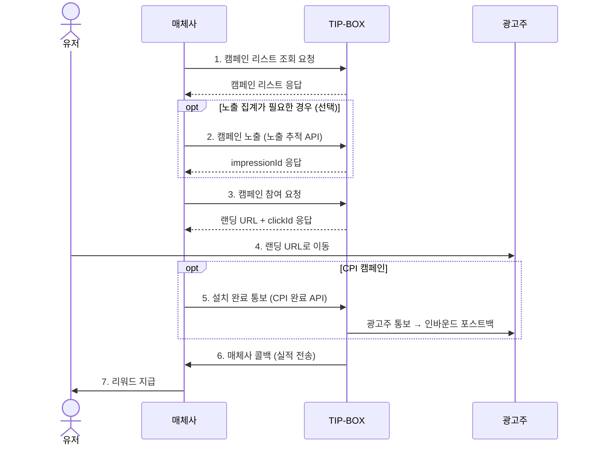
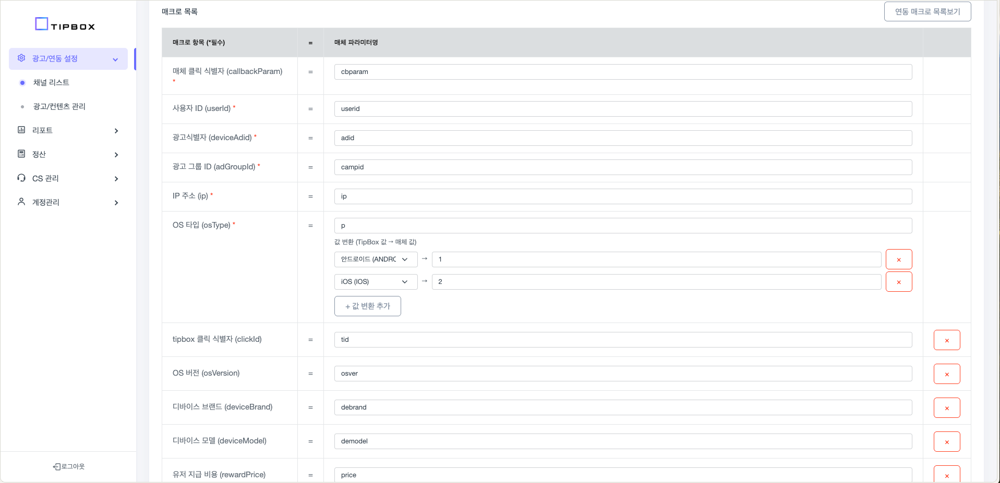

# Offerwall API guide for publisher

### Getting Started

- 본 가이드는 TIP-BOX **오퍼월** 캠페인과 매체사 API 연동에 대한 내용입니다
- TIP-BOX의 오퍼월 리워드 캠페인을 연동하여 사용자에게 캠페인을 노출하고, 참여 실적에 따라 리워드를 지급할 수 있습니다
- DA(디스플레이) 광고 연동은 [DA API guide for publisher](DA%20API%20guide%20for%20publisher.md) 를 참고해주세요

### 연동 흐름도



### Prerequisites

- TIP-BOX 매체 어드민에서 **오퍼월 타입** 채널을 등록하고, 승인(ACTIVE) 후 발급되는 channelKey를 API 인증에 사용합니다
  (채널 타입이 오퍼월이 아닌 channelKey로 호출하면 `CHANNEL_TYPE_MISMATCH` 오류가 반환됩니다)
- 채널 등록 시 실적 수신을 위한 콜백 URL을 함께 설정합니다

---
# 1.캠페인 리스트 조회 API

- 5분 주기로 업데이트 받는 것을 추천드립니다
- method : GET
- production API url : https://ad.tip-box.kr/api/v1/reward/offerwall/campaigns
- test API url : http://dev.qtbit.co.kr:8037/api/v1/reward/offerwall/campaigns

- parameter : channelKey (필수), p (선택), category (선택)


| 항목         | 설명      | 필수 | 비고                                                                         |
|------------|---------|----|----------------------------------------------------------------------------|
| channelKey | 매체사 채널 식별키 | O  | 매체 어드민에서 채널 승인 시 발급                                                       |
| p        | 플랫폼     |    | 기본 값은 전체이며, 구분하여 받을 경우 Android : 1, iOS : 2로 요청                            |
| category | 카테고리    |    | 기본 값은 전체이며, 구분하여 받을 경우 보험 : 01, 금융 : 02, 자동차보험 : 03, 카드 : 04, 기타 : 99로 요청 |

> `category` 파라미터는 현재 값 체계를 정비 중입니다. 별도 안내 전까지는 전송하지 않는 것을 권장합니다 (전송 시 빈 리스트가 반환될 수 있습니다).

- 요청 예시 : https://ad.tip-box.kr/api/v1/reward/offerwall/campaigns?channelKey={channelKey}


| 항목                   | 형태            | 설명                                     | 비고                                                                                                          |
|----------------------|---------------|----------------------------------------|-------------------------------------------------------------------------------------------------------------|
| result               | int           | 응답 결과 값                                | 200인 경우에만 정상, '결과 코드' 참고                                                                                    |
| cnt                  | int           | 캠페인 수                                  |                                                                                                             |
| camp                 | array         | 캠페인 리스트                                |                                                                                                             |
| camp.adGroupId       | long          | 캠페인 식별값                                |                                                                                                             |
| camp.os              | string(7)     | 모바일 OS                                 | android, ios, WEB (WEB은 모든 OS 호환)                                                                           |
| camp.name            | string(255)   | 캠페인명                                   |                                                                                                             |
| camp.bm              | int           | 캠페인 유형                                 | 1: CPA/MISSION, 2: CPE, 3: CPI, 4: CPS, 0: 기타(CPC, CPV, CPM)                                                |
| camp.type            | string(7)     | 캠페인 문자열 유형                                | MISSION, CPA, CPE, CPI, CPS, CPC, CPV, CPM                                                                  |
| camp.answer_type     | int           | 정답 제출 방식                               | *아래 표 참고<br/>예시: 101 저장하기(스크린샷) 102 저장하기(텍스트), 201 퀴즈맞추기(텍스트 쇼핑), 202 퀴즈맞추기(텍스트 장소), ... 601 SNS(인스타그램 팔로우) |
| camp.package         | string(100)   | 패키지네임 또는 url scheme                    | android: package name, iOS: custom url(CPI 또는 CPE인 경우 제공)                                                   |
| camp.price           | int           | 캠페인 집행 단가 (=매체비)                       | 100                                                                                                         |
| camp.price_dollar    | double        | 캠페인 집행 단가 (=매체비, USD)                  | 0.014                                                                                                       |
| camp.rewarddesc      | string(50)    | 캠페인 적립 조건 안내 (불필요한 태그 제거)              | ex) 앱 설치 후 회원가입 완료                                                                                          |
| camp.raw_rewarddesc  | string(50)    | 캠페인 적립 조건 안내                           | ex) 앱 설치 후 회원가입 완료                                                                                          |
| camp.joindesc        | string(65535) | 캠페인 참여 방법 안내 (불필요한 태그 제거)              |                                                                                                             |
| camp.raw_joindesc    | string(65535) | 캠페인 참여 방법 안내                           |                                                                                                             |
| camp.totalquantity   | int           | 해당 캠페인의 참여 가능한 총 수량                    | 0: 무제한                                                                                                      |
| camp.quantity        | int           | 해당 캠페인의 일별 참여 가능 수량(=매체사에 할당된 데일리 캡)   | 0: 무제한                                                                                                      |
| camp.enddate         | string(8)     | 캠페인 종료일                                | 1) 값이 있는 경우: YYYYMMDD 2) 값이 없는 경우: 별도 종료일 없음                                                                |
| camp.day_event_limit | int           | 일일 사용자당 참여 가능 횟수                       | 0: 단 한번만 참여 가능, 1: 하루 한번 참여 가능, N: 하루 N번 참여 가능                                                              |
| camp.ad_event_limit  | int           | 사용자당 참여 가능 총 횟수                        |                                                                                                             |
| camp.targetcarrier   | string(1)     | 통신사 타겟팅                                | 공백: 타겟 없음, 1: KT, 2: LGU+, 3: SKT                                                                           |
| camp.targetgender    | int           | 성별 타겟팅                                 | 0: 타겟 없음, 1: 남자, 2: 여자                                                                                      |
| camp.targetagemin    | int           | 최소 연령 타겟팅                              | 0: 타겟 없음                                                                                                    |
| camp.targetagemax    | int           | 최대 연령 타겟팅                              | 0: 타겟 없음                                                                                                    |
| camp.targetpkg       | string(100)   | 앱 패키지네임 타겟팅. AOS 캠페인일 경우에만 내려옵니다       |                                                                                                             |
| camp.detargetpkg     | string(100)   | 앱 패키지네임 디타겟팅. AOS 캠페인일 경우에만 내려옵니다      |                                                                                                             |
| camp.iconurl         | string(255)   | 캠페인의 아이콘 이미지 url                       |                                                                                                             |
| camp.ctv             | array         | 아이콘 이미지를 제외한 가로형, 세로형 소재 정보를 포함하고 있습니다 | 세부 항목 참고                                                                                                    |


camp -> ctv 세부 항목

| 항목   | 형태          | 설명                            |
|------|-------------|-------------------------------|
| type | int         | 1:가로형 소재, 1200*600, 2:1 ratio |
|      |             | 2:세로형 소재, 720*780             |
|      |             | 3:세로형 소재, 640*960             |
|      |             | 4:가로형 소재, 640*100             |
| url  | string(255) | 소재 url                        |

camp -> answer_type 세부 항목

| answer_type | 하위 유형        | 설명                      |
|-------------|---------------|-------------------------|
| 101         | 저장하기          | 스크린샷                    |
| 102         | 저장하기          | 텍스트                     |
| 201         | 퀴즈맞추기         | 텍스트(쇼핑)                 |
| 202         | 퀴즈맞추기         | 텍스트(장소)                 |
| 203         | 퀴즈맞추기         | 텍스트(블로그, 홈페이지, 기타)      |
| 301         | 상품찜           | 스크린샷(네이버쇼핑)             |
| 302         | 상품찜           | 스크린샷(카카오쇼핑)             |
| 303         | 상품찜           | 스크린샷(카카오선물하기)           |
| 304         | 상품찜           | 스크린샷(무신사)               |
| 305         | 상품찜           | 스크린샷(에이블리)              |
| 401         | 알림받기          | 스크린샷                    |
| 402         | 알림받기          | 텍스트                     |
| 501         | 유튜브           | 스크린샷(시청)                |
| 502         | 유튜브           | 스크린샷(구독)                |
| 503         | 유튜브           | 스크린샷(쇼츠좋아요)             |
| 504         | 유튜브           | 스크린샷(영상좋아요)             |
| 505         | 유튜브           | 스크린샷(영상좋아요+채널구독)        |
| 601         | SNS           | 스크린샷(인스타그램 팔로우)         |
| 602         | SNS           | 스크린샷(인스타그램 게시물 좋아요)     |
| 603         | SNS           | 스크린샷(카카오 채널 추가)         |


#### 응답 예시
```json
{
    "result": 200,
    "cnt": 2,
    "camp": [
        {
          "adGroupId": 415405,
          "name": "A 강남역 맛집 우대포 강남역점 육회 명소 퀴즈맞추기",
          "bm": 1,
          "type": "MISSION",
          "answer_type": 201,
          "price": 20,
          "price_dollar": 0.014,
          "rewarddesc": "퀴즈 정답 입력하기",
          "joindesc": "[참여방법]\r\n1. 미션 페이지 클릭하기\r\n2. 강남역 맛집 우대포 강남역점 육회 <- 복사하기, \r\n3. 붙여넣기 후 해당 플레이스 클릭 -> 주변 -> 명소 클릭\r\n4. {명소} 1번째 장소는? 단어를 입력 하면 완료!\r\n\r\n\r\n[주의사항] \r\n이미 참여한 이력이 있다면 리워드가 지급되지 않을 수 있습니다. \r\nWIFI가 아닌 환경에서는 데이터 이용료가 발생할 수 있습니다.",
          "raw_rewarddesc": "퀴즈 정답 입력하기",
          "raw_joindesc": "<p>[참여방법]</p><p>1. 미션 페이지 클릭하기<br>2. 강남역 맛집 우대포 강남역점 육회 &lt;- 복사하기,<br>3. 붙여넣기 후 해당 플레이스 클릭 -&gt; 주변 -&gt; 명소 클릭<br>4. {명소} 1번째 장소는? 단어를 입력 하면 완료!</p><p>[주의사항]</p><p>이미 참여한 이력이 있다면 리워드가 지급되지 않을 수 있습니다.<br>WIFI가 아닌 환경에서는 데이터 이용료가 발생할 수 있습니다.</p>",
          "totalquantity": 14000,
          "quantity": 2000,
          "enddate": "20240724",
          "targetcarrier": "",
          "targetgender": 0,
          "targetagemin": 0,
          "targetagemax": 0,
          "targetpkg": "",
          "detargetpkg": "",
          "ad_event_limit": 9999,
          "iconurl": "https://webapp.superap.io/res/quiz_icon.png",
          "ctv": [
            {
              "type": 1,
              "url": "https://webapp.superap.io/res/quiz_1200-600_1.png"
            },
            {
              "type": 2,
              "url": "https://webapp.superap.io/res/quiz_720-780_1.png"
            }
          ]
        },
        {
            "adGroupId": 405080,
            "name": "목포 맛집 목포관광오리탕 오리탕 저장하기",
            "bm": 1,
            "type": "MISSION",
            "answer_type": 101,
            "price": 19,
            "price_dollar": 0.013,
            "rewarddesc": "플레이스 저장하기",
            "joindesc": "[참여방법]\r\n1. 미션 페이지 클릭 -> 플레이스 더보기 클릭 후\r\n2. 홈 메뉴에서 플레이스 저장 하고 저장된 화면 캡쳐하기 \r\n3. 돌아와서 캡쳐화면 업로드 하면 완료! \r\n\r\n\r\n\r\n\r\n[주의사항]\r\n이미 참여한 이력이 있다면 리워드가 지급되지 않을 수 있습니다.\r\nWIFI가 아닌 환경에서는 데이터 이용료가 발생할 수 있습니다.",
            "raw_rewarddesc": "플레이스 저장하기",
            "raw_joindesc": "<p>[참여방법]</p><p>1. 미션 페이지 클릭 -&gt; 플레이스 더보기 클릭 후<br>2. 홈 메뉴에서 플레이스 저장 하고 저장된 화면 캡쳐하기<br>3. 돌아와서 캡쳐화면 업로드 하면 완료!</p><p>[주의사항]</p><p>이미 참여한 이력이 있다면 리워드가 지급되지 않을 수 있습니다.<br>WIFI가 아닌 환경에서는 데이터 이용료가 발생할 수 있습니다.</p>",
            "totalquantity": 6000,
            "quantity": 200,
            "enddate": "20240728",
            "targetcarrier": "",
            "targetgender": 0,
            "targetagemin": 0,
            "targetagemax": 0,
            "targetpkg": "",
            "detargetpkg": "",
            "ad_event_limit": 1,
            "iconurl": "https://webapp.superap.io/res/place_icon.png",
            "ctv": [
              {
                "type": 1,
                "url": "https://webapp.superap.io/res/place_1200-600_2.png"
              },
              {
                "type": 2,
                "url": "https://webapp.superap.io/res/place_720-780_2.png"
              }
            ]
        }
    ]
}
```

---
# 2.캠페인 노출 추적 API

- 오퍼월 캠페인이 사용자에게 노출되는 시점에 호출하여 노출을 집계합니다.
- 노출 집계가 필요한 경우에만 선택적으로 호출하며, 참여/적립의 필수 선행 조건은 아닙니다.
- 서버는 노출 요청을 중복 제거하지 않습니다. 호출할 때마다 노출 1건으로 집계되므로 실제 노출 1회당 1번만 호출해주세요.

### 요청
- method : GET
- production API url : https://reward.tip-box.kr/api/impression
- test API url : https://dev.qtbit.co.kr:8436/api/impression

> **매크로 매핑 기반 파라미터 전달**
>
> GET 방식은 참여 요청 API와 동일하게 매체 어드민의 **채널 관리 > 매크로 설정**에서 구성한 매크로 매핑에 따라 파라미터가 처리됩니다.
> 매체사는 자사 시스템의 파라미터명으로 값을 전달하면, TIP-BOX가 매크로 매핑 설정에 따라 내부 필드로 자동 변환합니다.

#### 필수 파라미터

아래는 내부적으로 매핑되어야 하는 필수 필드 목록입니다. GET의 실제 Query Parameter명은 매크로 매핑 설정에 따라 달라질 수 있습니다.

| 항목                   | 형태     | 필수 | 설명                                              |
|----------------------|--------|----|-------------------------------------------------|
| channelKey           | string | O  | 매체사 채널 식별키 (매크로 매핑 대상이 아닌 고정 파라미터입니다)          |
| userId               | string | O  | 참여 유저 식별값 (최대 255자)                             |
| adId (또는 adGroupId) | long   | O  | 광고(그룹) 식별값. 둘 중 하나는 반드시 존재해야 합니다               |
| osType               | string | O  | 모바일 OS (ANDROID, IOS). adGroupId와 함께 광고 조회에 사용됩니다  |

#### 선택 파라미터

| 항목            | 형태     | 설명                     |
|---------------|--------|------------------------|
| ip            | string | 참여 단말기 IP              |
| osVersion     | string | OS 버전                  |
| deviceModel   | string | 단말기 모델                 |
| deviceBrand   | string | 단말기 제조사                |
| deviceNetwork | string | 네트워크 타입 (WIFI, MOBILE) |
| deviceCarrier | string | 통신사 (SKT, KT, LGU+)    |
| deviceAdid    | string | 광고 식별자 (ADID/IDFA)     |
| userAgent     | string | User-Agent             |

### 응답
| 항목                 | 형태     | 설명                       |
|--------------------|--------|--------------------------|
| status             | int    | HTTP 상태 코드               |
| code               | string | 응답 코드 (OK)               |
| message            | string | 응답 메시지                   |
| data.impressionId  | string | 노출 식별값 (MongoDB ObjectId) |

#### 응답 예시
```json
{
    "status": 200,
    "code": "OK",
    "message": "ok",
    "data": {
        "impressionId": "507f1f77bcf86cd799439011"
    }
}
```

> **에러 응답**
>
> 에러가 발생해도 HTTP 상태 코드는 200으로 응답하며, 응답 본문의 `status`·`code` 로 결과를 구분합니다.
> - 400 : 잘못된 요청 (`VALIDATION_FAILED` 필수 파라미터 누락, `CHANNEL_TYPE_MISMATCH` 채널 타입과 광고 형식 불일치)
> - 405 : 매체 또는 광고를 찾을 수 없음 (`MEDIA_NOT_FOUND`, `AD_NOT_FOUND` — adGroupId·osType 조합에 해당하는 광고 없음 포함)
> - 406 : 승인 대기·비활성·거절된 채널 (`CHANNEL_PENDING`, `CHANNEL_INACTIVE`, `CHANNEL_REJECTED`)
> - 502 : 종료되었거나 진행 중이 아닌 캠페인 (`AD_ENDED`)

---
# 3.캠페인 참여 요청 API


- 광고에 참여하기 위해서는 캠페인 참여 요청 API를 호출해 참여 가능 여부를 확인해야 합니다.
- 참여 유저의 데이터 정보를 많이 전달 할 수록 더 많은 캠페인에 참여할 수 있습니다.

### 요청
- method : GET
- production API url : https://reward.tip-box.kr/api/participate
- test API url : https://dev.qtbit.co.kr:8436/api/participate

> **매크로 매핑 기반 파라미터 전달**
>
> 참여 요청 API는 콜백과 동일하게 매체 어드민의 **채널 관리 > 매크로 설정**에서 구성한 매크로 매핑에 따라 파라미터가 처리됩니다.
> 매체사는 자사 시스템의 파라미터명으로 값을 전달하면, TIP-BOX가 매크로 매핑 설정에 따라 내부 필드로 자동 변환합니다.
>
> 예를 들어, 매크로 매핑에서 `"userId": "uid"` 로 설정한 경우:
> ```
> /api/participate?channelKey=xxx&uid=user123&adGroupId=415405&...
> ```
> `uid` 파라미터가 내부적으로 `userId`로 매핑됩니다.

#### 필수 파라미터

아래는 내부적으로 매핑되어야 하는 필수 필드 목록입니다. 실제 Query Parameter명은 매크로 매핑 설정에 따라 달라질 수 있습니다.

| 항목         | 형태     | 필수 | 설명                                                   |
|------------|--------|----|------------------------------------------------------|
| channelKey | string | O  | 매체사 채널 식별키 (매체 어드민에서 발급). 매크로 매핑 대상이 아닌 고정 파라미터입니다   |
| userId     | string | O  | 참여 유저 식별값                                            |
| adGroupId  | long   | O  | 광고 식별값 |
| osType     | string | O  | 모바일 OS (ANDROID, IOS). adGroupId와 함께 광고 조회에 사용되며, 누락 시 광고를 찾을 수 없습니다 |
| callbackParam | string | O | 매체사 정의 파라미터. 포스트백(콜백)을 통해 다시 전달받을 수 있는 값입니다. 매크로 매핑이 설정된 채널은 값이 비어 있으면 요청이 거부됩니다 |
| ip         | string | O  | 참여 단말기 IP                                            |
| deviceAdid | string | O  | 광고 식별자 (Android: ADID, iOS: IDFA)                    |

#### 선택 파라미터

| 항목            | 형태      | 설명                              | 비고                                              |
|---------------|---------|----------------------------------|---------------------------------------------------|
| impressionId  | string  | 노출 식별값                         | 섹션 2 노출 추적 API 응답의 `impressionId`. 매크로 매핑 대상이 아니며 파라미터명 `impressionId` 그대로 전달합니다 |
| osVersion     | string  | OS 버전                           |                                                   |
| deviceModel   | string  | 단말기 모델                          |                                                   |
| deviceBrand   | string  | 단말기 제조사                         |                                                   |
| deviceNetwork | string  | 네트워크 타입                         | 3G, 4G, 5G, WIFI                                  |
| deviceCarrier | string  | 통신사                             | SKT, KT, LGU+                                    |
| userAgent     | string  | User-Agent                       |                                                   |
| affiliateId   | string  | 하위 매체 아이디                       |                                                   |
| age           | int     | 유저 연령 정보                        | 연령 타겟팅 캠페인일 경우 필수                                |
| gender        | int     | 유저 성별 정보                        | 0: 모름, 1: 남자, 2: 여자. 성별 타겟팅 캠페인일 경우 필수           |

### 응답
| 항목              | 형태     | 설명              |
|-----------------|--------|-----------------|
| status          | int    | HTTP 상태 코드      |
| code            | string | 응답 코드           |
| message         | string | 응답 메시지          |
| data.landingUrl | string | 캠페인 랜딩 URL      |
| data.clickId    | string | 클릭 식별값          |
| data.needsComplete | boolean | CPI 완료 통보(섹션 4-3) 호출 필요 여부 |

#### 응답 예시
```json
{
    "status": 200,
    "code": "OK",
    "message": "ok",
    "data": {
        "landingUrl": "https://example.com/campaign/landing?click_id=abc123",
        "clickId": "abc123",
        "needsComplete": false
    }
}
```

> 에러가 발생해도 HTTP 상태 코드는 200으로 응답하며, 응답 본문의 `status`·`code` 로 결과를 구분합니다. 이 경우 `data` 는 내려가지 않습니다. 코드 목록은 '결과 코드'를 참고해주세요.

---
# 4.설치형(CPI) 캠페인

- 본 섹션은 CPI(앱 설치) 캠페인에만 해당하는 안내입니다.

### 4-1. 개요
- CPI 캠페인 참여는 섹션 3의 캠페인 참여 요청 API를 동일하게 호출하는 것으로 시작합니다.
- 참여 요청 API 응답으로 앱스토어 랜딩 URL과 clickId가 전달됩니다.
- 참여 요청 API 응답의 `data.needsComplete` 가 `true` 인 경우 설치 완료 후 CPI 완료 API(4-3)를 호출해야 합니다.
- 요청 파라미터는 섹션 3을 참고해주세요.

### 4-2. CPI 전환 인정 흐름

CPI 전환은 매체사가 설치 완료를 통보하는 방식으로 인정됩니다.

1. 매체사가 설치 완료를 확인한 뒤, CPI 완료 API(4-3)를 호출해 완료를 통보합니다.
2. TIP-BOX가 광고주에게 완료를 통보하고, 되돌아오는 인바운드 포스트백으로 전환을 확정합니다.
3. 전환이 확정되면 매체사 서버로 실적 콜백이 전송됩니다 (섹션 5 참고).

### 4-3. 설치형(CPI) 참여 완료 API

- 매체사가 CPI 설치 완료를 TIP-BOX로 통보하는 API입니다.
- **본 API의 200 응답은 "완료 통보 접수됨"을 의미하며, 리워드 적립 완료를 보장하지 않습니다.** 실제 적립은 되돌아오는 인바운드 포스트백 → 매체사 콜백(섹션 5)을 통해 처리됩니다.

#### 요청
- method : GET
- production API url : https://reward.tip-box.kr/api/participate/complete
- test API url : https://dev.qtbit.co.kr:8436/api/participate/complete

| 항목         | 형태     | 필수 | 설명                                                      |
|------------|--------|----|---------------------------------------------------------|
| channelKey | string | O  | 매체사 채널 식별키                                              |
| clickId    | string | O  | 완료 대상 참여 ID. 섹션 3 참여 요청 응답의 `clickId` 값을 그대로 사용합니다     |

#### 응답
| 항목      | 형태     | 설명                    |
|---------|--------|-----------------------|
| status  | int    | HTTP 상태 코드            |
| code    | string | 응답 코드                 |
| message | string | 응답 메시지                |

#### 응답 예시
```json
// 완료 통보 접수 (성공 또는 멱등)
{
    "status": 200,
    "code": "ACCEPTED",
    "message": "완료 통보가 접수되었습니다."
}
```
```json
// 완료 통보 실패
{
    "status": 900,
    "code": "COMPLETE_FAILED",
    "message": "완료 통보에 실패했습니다."
}
```

> **에러 응답**
> - 400 : 비-CPI 광고 등 잘못된 요청
> - 405 : 매체/참여를 찾을 수 없음 (유효하지 않은 clickId 포함)

---
# 5.실적 전송 (콜백)

- 캠페인을 정상적으로 참여 완료했을 때, 매체사 서버로 리워드 적립 요청을 보냅니다
  (폐사에서 직접 적립 처리하지 않습니다)
- 리워드 적립 요청을 받을 콜백 URL은 매체 어드민의 채널 설정에서 등록합니다
- 콜백은 HTTP GET 또는 POST 방식으로 전송됩니다 (매체사 설정에 따라 결정)

### 콜백 매크로

TIP-BOX는 매체사별로 콜백 URL의 파라미터 구성을 동적으로 설정할 수 있습니다.
매체사의 콜백 URL과 매크로 매핑은 매체 어드민의 **채널 관리 > 매크로 설정**에서 설정하며, 아래의 매크로를 사용할 수 있습니다.

> 매체사의 기존 콜백 스펙에 맞추어 파라미터명과 값을 자유롭게 매핑할 수 있습니다.



#### 사용 가능한 매크로 목록

**식별 정보**

| 매크로명        | 설명                    |
|---------------|-----------------------|
| clickId       | 클릭 트래킹 ID            |
| userId        | 참여 유저 식별값             |
| affiliateId   | 하위 매체 아이디             |
| mediaId       | 매체 계정 ID              |
| deviceAdid    | 광고 식별자 (ADID/IDFA)    |
| callbackParam | 매체사 정의 파라미터           |

**캠페인 정보**

| 매크로명          | 설명                   |
|----------------|----------------------|
| campaignId     | 캠페인 ID               |
| adGroupId      | 광고그룹 ID              |
| adFormat       | 광고 형식 (오퍼월 캠페인은 OFFERWALL) |
| adType         | 광고 유형 (CPI, CPE, CPA, MISSION, CPS, CPC, CPV, CPM) |
| mediaName      | 매체사명                 |

**금액 정보**

| 매크로명          | 설명           |
|----------------|--------------|
| mediaPrice    | 매체 지급액       |
| profit         | 매체 수익        |
| userPrice      | 유저 지급액 (원) |
| userPoint      | 유저 포인트    |

**디바이스 정보**

| 매크로명         | 설명                   |
|---------------|----------------------|
| ip            | 참여 단말기 IP             |
| osType        | OS 유형 (ANDROID, IOS)  |
| osVersion     | OS 버전                |
| deviceModel   | 단말기 모델               |
| deviceBrand   | 단말기 제조사              |
| deviceCarrier | 통신사                  |
| deviceNetwork | 네트워크 타입              |
| userAgent     | User-Agent            |

**유저 정보**

| 매크로명   | 설명     |
|---------|--------|
| age     | 유저 연령  |
| gender  | 유저 성별  |

**기타**

| 매크로명           | 설명                   |
|-----------------|----------------------|
| clickTimestamp   | 클릭 시각 (KST epoch)   |

#### 동적 매크로 매핑 방식

매크로 매핑은 JSON 형태로 설정되며, 두 가지 방식을 지원합니다.

**1) 단순 매핑** : 매크로 값을 그대로 파라미터에 전달

```json
{
  "userId": "uid",
  "clickId": "click_id",
  "profit": "pft"
}
```
- 형식 : `"매크로명": "파라미터명"`
- 위 설정시 콜백 URL에 `uid={userId값}&click_id={clickId값}&pft={profit값}` 형태로 전달됩니다

**2) 열거형 매핑** : 매크로 값을 매체사에서 사용하는 코드값으로 변환하여 전달

```json
{
  "osType": {
    "paramName": "os",
    "values": {
      "IOS": "1",
      "ANDROID": "2"
    }
  }
}
```
- 형식 : `"매크로명": { "paramName": "파라미터명", "values": { "원래값": "변환값" } }`
- 위 설정시 OS가 IOS인 경우 `os=1`, ANDROID인 경우 `os=2`로 전달됩니다

#### 동적 매크로 설정 예시

아래는 매체사 콜백 URL과 매크로 매핑의 전체 예시입니다.

**콜백 URL** : `https://publisher.com/callback`

**매크로 매핑 설정** :
```json
{
  "userId": "uid",
  "clickId": "click_id",
  "campaignId": "cid",
  "mediaPrice": "price",
  "callbackParam": "cb",
  "osType": {
    "paramName": "os",
    "values": {
      "IOS": "1",
      "ANDROID": "2"
    }
  }
}
```

**실제 전송되는 콜백 URL** :
```
https://publisher.com/callback?uid=user123&click_id=663f1a2b3c4d5e6f&cid=12345&price=100&cb=my_param&os=2
```

---
## 공통
- 캠페인 리스트 조회 / 참여 요청 API의 `result`(또는 `status`)로 반환되는 코드 목록입니다
- 노출 추적 API·CPI 완료 API는 각 섹션에 명시된 `code`(OK / ACCEPTED / COMPLETE_FAILED 등)와 HTTP 상태 코드를 따릅니다

### result code

| 항목  | 내용           |
|-----|--------------|
| 200 | 성공           |
| 300 | 검토중으로 적립 대기  |
| 400 | 잘못된 요청       |
| 401 | 등록되지 않은 매체   |
| 402 | 유저 정보 오류     |
| 403 | 캠페인 정보 오류    |
| 405 | 참여 이력 오류     |
| 406 | 매체 오류        |
| 407 | 타겟팅 매칭 실패    |
| 500 | 종료된 캠페인      |
| 501 | 중복 참여        |
| 502 | 참여할 수 없는 캠페인 |
| 900 | 시스템 오류       |

## Authors

* **CHOI BAWOO** - *Integration technical support* - bw@adbc.co.kr


